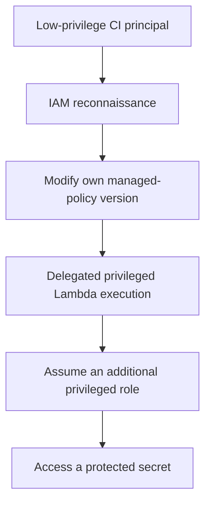
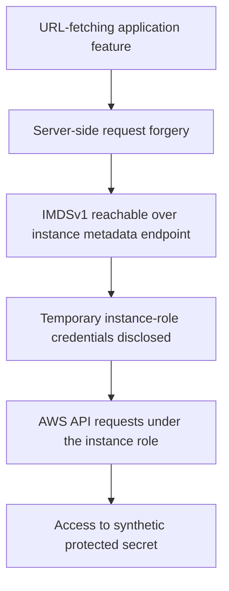

# Attack-Path Analysis

**Evidence classification:** Scenario-defined sequences drawn from independent disposable laboratories; **not re-executed for this publication**. The paths are presented for defensive analysis, not as executable payload instructions.

## Path A — CI identity to protected production secret (Lab 14)

| Phase | Required weakness | Expected security consequence | Principal defensive control |
| --- | --- | --- | --- |
| Initial access | CI credential can authenticate | AWS control-plane foothold | Short-lived federation, CI credential governance |
| Enumeration | Broad IAM read permissions | Discovery of attached policy and role trusts | Narrow IAM read visibility where feasible; review sensitive metadata |
| Privilege escalation | `iam:CreatePolicyVersion` on an attached policy and ability to activate a permissive version | CI user can expand its own effective permissions | Separate IAM policy administration; remove self-management |
| Service-role escalation | `iam:PassRole` and Lambda creation/invocation with a privileged role | Code executes with permissions the CI user does not directly hold | Constrain passable roles, service and resources; restrict execution roles |
| Further role assumption | The execution principal can assume a trusted privileged role | Administrative privileges via STS | Tighten role trust and identity permissions; validate combined conditions |
| Data access | Privileged identity can access the final secret | Sensitive data compromise | Least privilege, secret-scoped policies, auditing and monitoring |

**Necessary qualification:** `iam:PassRole` is not itself `sts:AssumeRole`; Lambda assumes its execution role based on the role's trust and IAM permissions. The next role hop additionally requires a compatible trust relationship and suitable `sts:AssumeRole` authorisation. The exercise intentionally supplies those preconditions.

**Evidence required to assert confirmation:** pre/post IAM policy version, principal ARN, relevant Lambda execution-role trust and attached policies, CloudTrail events, sanitised STS identity output and proof of authorised access to a synthetic secret.

## Path B — SSRF to EC2 credentials (Lab 11)

| Phase | Exposure | Defender action |
| --- | --- | --- |
| Web request | Untrusted user controls a server-side URL fetch | Restrict allowed schemes and destinations; block internal and link-local targets; prevent redirect bypass |
| Metadata access | IMDSv1 still available (`HttpTokens=optional`) | Require IMDSv2 after compatibility testing |
| Credential privilege | Instance role can read a target secret | Limit instance role to actual workload needs; restrict secret/KMS access |
| Detection | Instance credentials used outside intended workload | Investigate CloudTrail context and relevant GuardDuty findings |

**Qualification:** IMDSv2 materially reduces the documented simple GET-only SSRF path but is not a universal SSRF defence. IMDS hop limit 1 is a common hardening preference but is workload-dependent (some container/network setups need a different value). The application SSRF must still be fixed.

**Evidence required:** a sanitised SSRF request/response demonstrating server-side retrieval, instance metadata settings, role trust and permission policies, a safe synthetic-resource access result and the after-hardening application regression test.

## Path independence and reporting integrity

Lab 14 and lab 11 were **not** demonstrated as an end-to-end chain in the same account. Other labs describe independent issues (S3, EBS and trust policy). Linking these beyond their original briefs would misrepresent the available evidence.

## Security engineering takeaway

A meaningful attack-path finding needs both **a plausible chain of permissions** and **a bounded test verifying the effect**. Tool suggestions alone do not establish execution or real-world impact.
